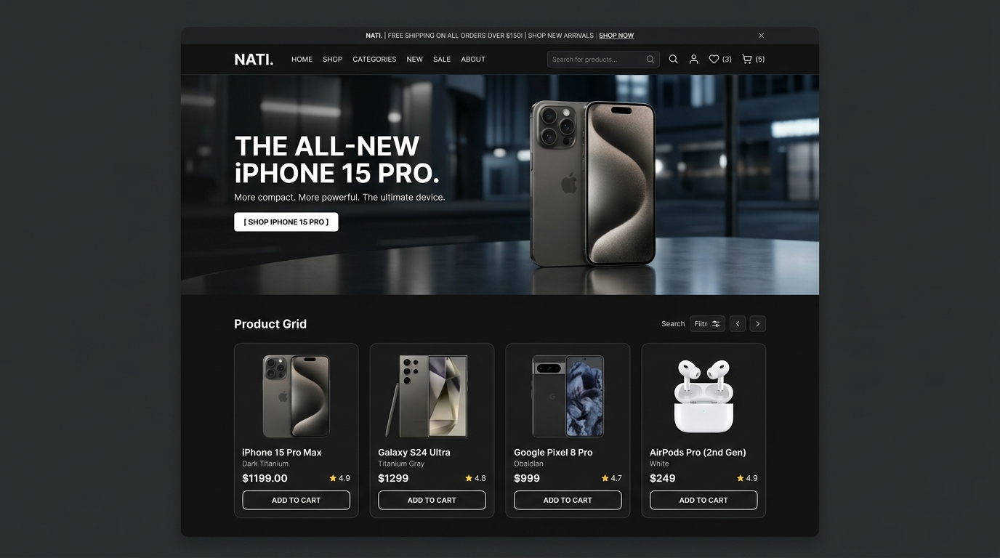
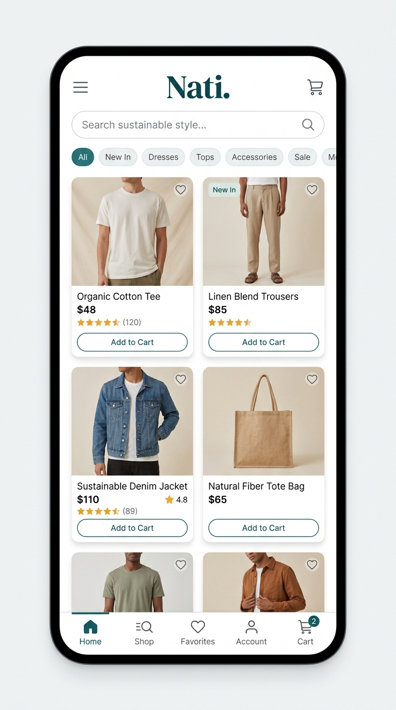
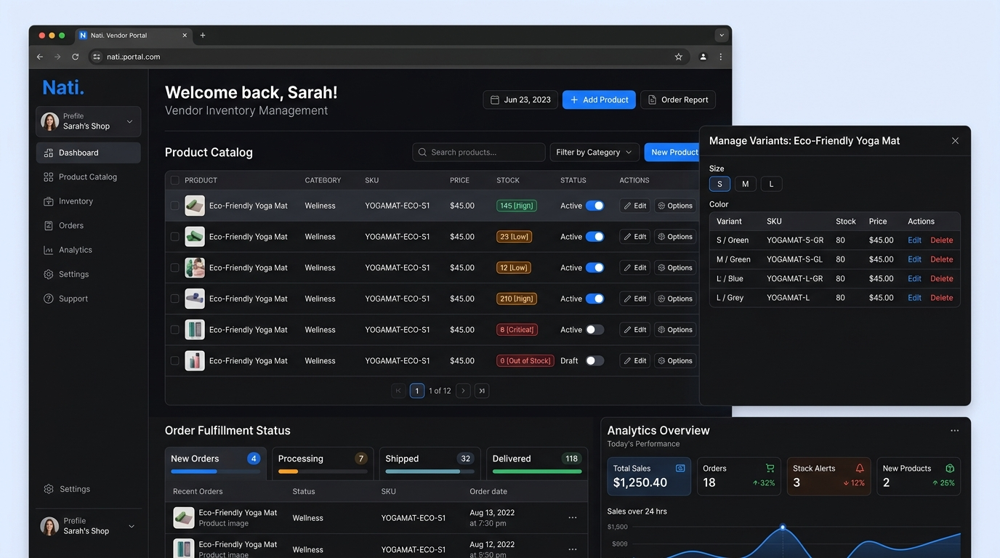
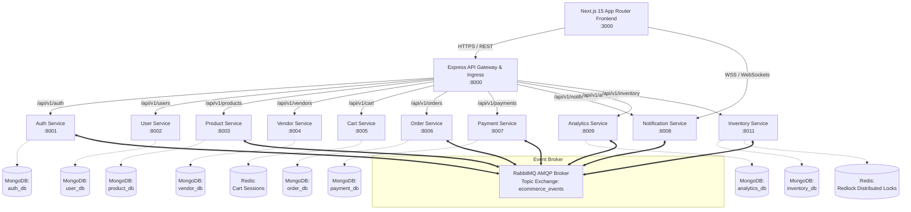
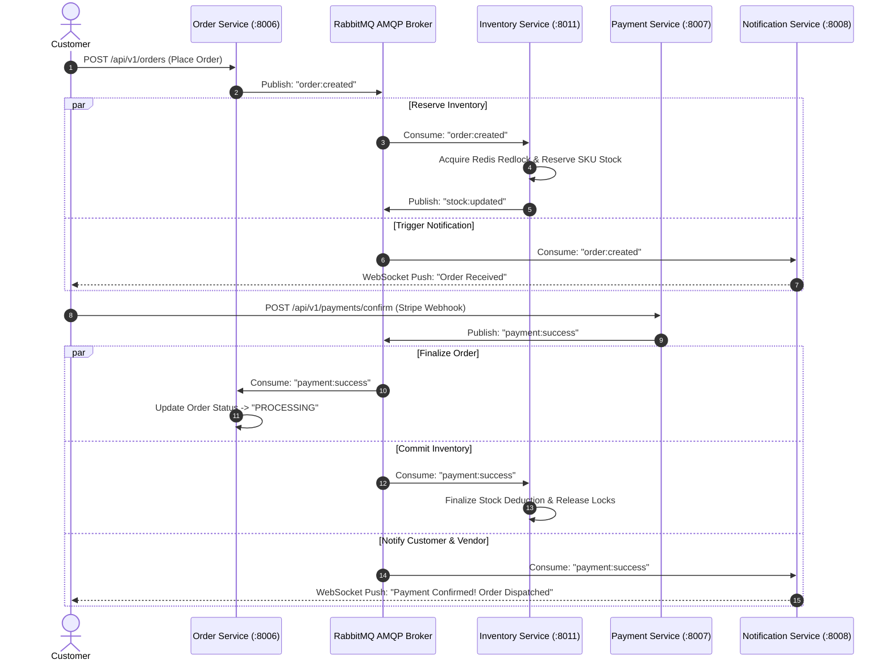

# 🛍️ Nati. — Enterprise Multi-Vendor E-Commerce Platform

> **A high-performance, event-driven e-commerce microservices ecosystem engineered for sub-second latency, zero-downtime scalability, distributed concurrency control, and mobile-first user experiences.**

[](https://nextjs.org/)
[](https://react.dev/)
[](https://www.typescriptlang.org/)
[](https://tailwindcss.com/)
[](https://nodejs.org/)
[](https://expressjs.com/)
[](https://www.mongodb.com/)
[](https://redis.io/)
[](https://www.rabbitmq.com/)
[](https://stripe.com/)
[](https://www.docker.com/)
[](https://www.terraform.io/)
[](https://playwright.dev/)
[](LICENSE)

---

## 📑 Table of Contents

- [Overview](#-overview)
  - [What the Project Does](#what-the-project-does)
  - [Why It Was Built](#why-it-was-built)
  - [Core Problems Solved](#core-problems-solved)
- [Visual Showcase & Screenshots](#-visual-showcase--screenshots)
- [System Architecture & Topology](#-system-architecture--topology)
  - [High-Level Architectural Diagram](#high-level-architectural-diagram)
  - [Microservices Catalog & Port Allocation](#microservices-catalog--port-allocation)
  - [Event-Driven AMQP Messaging & Domain Events](#event-driven-amqp-messaging--domain-events)
  - [Flash-Sale Concurrency Control (Redis Redlock)](#flash-sale-concurrency-control-redis-redlock)
- [Comprehensive Feature Matrix](#-comprehensive-feature-matrix)
  - [1. Customer Storefront Experience](#1-customer-storefront-experience)
  - [2. Seller Vendor Portal (`/vendor`)](#2-seller-vendor-portal-vendor)
  - [3. Super Admin Telemetry Control Center (`/admin`)](#3-super-admin-telemetry-control-center-admin)
- [Technology Stack Deep Dive](#-technology-stack-deep-dive)
- [Project Directory Structure](#-project-directory-structure)
- [Getting Started & Local Setup](#-getting-started--local-setup)
  - [Prerequisites](#prerequisites)
  - [1. Clone Repository](#1-clone-repository)
  - [2. Option A: Native Monorepo Setup (Recommended for Dev)](#option-a-native-monorepo-setup-recommended-for-dev)
  - [3. Option B: Docker Compose Orchestration](#option-b-docker-compose-orchestration)
  - [4. Database Seeding & Default Credentials](#database-seeding--default-credentials)
- [Environment Variables Configuration](#-environment-variables-configuration)
  - [Frontend Environment (`frontend/.env.local`)](#frontend-environment-frontendenvlocal)
  - [Backend Ingress & Services Environment (`.env`)](#backend-ingress--services-environment-env)
- [Complete RESTful API Gateway Reference](#-complete-restful-api-gateway-reference)
  - [Standard Request & Response Envelopes](#standard-request--response-envelopes)
  - [Core Endpoint Specification](#core-endpoint-specification)
- [Testing & Quality Assurance](#-testing--quality-assurance)
  - [Type Checking & Linting](#type-checking--linting)
  - [Unit & Integration Testing](#unit--integration-testing)
  - [End-to-End Automated Testing (Playwright)](#end-to-end-automated-testing-playwright)
  - [High-Concurrency Load & Stress Testing (k6)](#high-concurrency-load--stress-testing-k6)
- [Security, Compliance & Threat Mitigation](#-security-compliance--threat-mitigation)
- [Performance Optimization & SLAs](#-performance-optimization--slas)
- [CI/CD & Cloud Deployment](#-cicd--cloud-deployment)
  - [GitHub Actions Workflows](#github-actions-workflows)
  - [Infrastructure as Code (Terraform)](#infrastructure-as-code-terraform)
  - [Render & Vercel Cloud Deployments](#render--vercel-cloud-deployments)
- [Architectural Decision Records (ADRs)](#-architectural-decision-records-adrs)
- [Comprehensive Documentation Hub](#-comprehensive-documentation-hub)
- [Contributing & Development Guidelines](#-contributing--development-guidelines)
- [License](#-license)
- [Author & Contact](#-author--contact)

---

## 🌟 Overview

### What the Project Does
**Nati.** is a production-grade, enterprise-ready multi-vendor e-commerce platform that seamlessly connects buyers, third-party sellers, and platform administrators within a single high-performance ecosystem. 

It provides an end-to-end shopping experience featuring real-time full-text catalog search, dynamic multi-variant matrices (SKU, color, storage, size), persistent Zustand carts and wishlists, multi-step checkout with Stripe PaymentIntents, automated seller fulfillment pipelines, and a live Super Admin Telemetry Mesh with real-time Gross Merchandise Value (GMV) and service health monitoring.

### Why It Was Built
Modern enterprise e-commerce applications must satisfy two critical requirements that often conflict:
1. **Ultra-Low User Latency & Flawless UX**: Delivering responsive, zero-layout-shift (CLS < 0.05) browsing across 320px mobile screens through 4K displays with sub-second page loads.
2. **Distributed Data Integrity Under Flash-Sale Concurrency**: Handling hundreds or thousands of simultaneous purchases of high-demand items without race conditions, stock overselling, or cascading database locks.

**Nati.** was engineered as a comprehensive portfolio centerpiece demonstrating senior-level full-stack engineering, event-driven microservices orchestration, distributed locking with Redis Redlock, transactional messaging with RabbitMQ, and rigorous mobile-first React 19 / Next.js 15 design.

### Core Problems Solved
| Challenge | Traditional Failure Mode | How Nati. Solves It |
| :--- | :--- | :--- |
| **Flash Sale Race Conditions** | Concurrent requests inspect stock > 0 simultaneously, resulting in negative inventory and oversold orders. | **Distributed Redis Redlock Algorithm**: Acquires an isolated distributed lock with automatic TTL release before inventory decrements, ensuring atomic stock mutations. |
| **Monolithic Choke Points** | Traffic spikes on catalog queries degrade checkout and payment processing. | **Decoupled Microservices**: 10 independent domain services running in dedicated processes with isolated MongoDB databases and RabbitMQ message queues. |
| **Dual-Write Inconsistencies** | Database update succeeds, but network drop causes message broker notification to fail. | **Transactional Outbox Pattern**: Database writes and outbound event records are committed within atomic database sessions; background relays publish events with guaranteed delivery. |
| **Mobile Conversion Drop-off** | Layout breaks, horizontal scrollbars, and heavy bundle downloads on 320px–480px viewports. | **Strict Mobile-First Design Tokens & Code Splitting**: Adaptive CSS grids, fluid touch targets (44px min), and `next/dynamic` chunking for zero layout shift. |

---

## 📸 Visual Showcase & Screenshots

Explore high-resolution captures of the three core platform user interfaces:

| Desktop Storefront Experience | Mobile 320px Zero-Shift Responsive View |
| :---: | :---: |
| [](docs/screenshots/desktop-storefront.jpg) | [](docs/screenshots/mobile-view.jpg) |
| *Full-width dynamic catalog, interactive variant matrices, and instant slide-over cart drawer.* | *Fluid 320px–480px layout without horizontal overflow, optimized touch targets, and bottom navigation bar.* |

| Super Admin Telemetry Mesh (`/admin`) | Seller Vendor Inventory Management (`/vendor`) |
| :---: | :---: |
| [](docs/screenshots/admin-dashboard.jpg) | [](docs/screenshots/vendor-portal.jpg) |
| *Live platform telemetry, GMV metrics, active users, and real-time microservice health pings.* | *Multi-variant SKU stock adjustments, price overrides, product catalog uploads, and order dispatching.* |

---

## 🏗️ System Architecture & Topology

### High-Level Architectural Diagram

The system adopts a decoupled event-driven microservices architecture fronted by an Express API Gateway and Nginx reverse proxy:



---

### Microservices Catalog & Port Allocation

Each service functions in its own decoupled runtime with dedicated storage boundaries:

| Service Name | Port | Database / Persistence | Responsibilities |
| :--- | :--- | :--- | :--- |
| **API Gateway** | `8000` | In-memory Rate Limiter | Ingress proxy, Helmet security, CORS origin verification, JWT context injection, ingress header stripping |
| **Auth Service** | `8001` | MongoDB (`auth_db`) | User authentication, bcryptjs hashing, JWT access & refresh token issuance, RBAC verification |
| **User Service** | `8002` | MongoDB (`user_db`) | Customer profiles, address book, password updates, account security preferences |
| **Product Service** | `8003` | MongoDB (`product_db`) | Product catalog, multi-category taxonomy, variant matrix definitions, customer ratings & reviews |
| **Vendor Service** | `8004` | MongoDB (`vendor_db`) | Seller onboarding, store verification (KYC), vendor product queues, payout balance tracking |
| **Cart Service** | `8005` | Redis (`cart_sessions`) | High-speed server-side shopping cart, session merging, guest-to-authenticated customer cart sync |
| **Order Service** | `8006` | MongoDB (`order_db`) | Order placement, checkout transaction orchestration, order status state machine, order history |
| **Payment Service** | `8007` | MongoDB (`payment_db`) | Stripe PaymentIntent generation, raw-signature webhook listeners, idempotency tracking, refunds |
| **Notification Service** | `8008` | In-Memory / Socket.IO | Real-time WebSocket notifications, customer order alerts, vendor dispatch notifications, email dispatch |
| **Analytics Service** | `8009` | MongoDB (`analytics_db`) | GMV calculation, live active visitor counting, conversion telemetry, Prometheus health scrape endpoints |
| **Inventory Service** | `8011` | MongoDB (`inventory_db`) & Redis | Real-time stock counts, multi-variant SKU reserves, distributed Redis Redlock locking algorithm |
| **Shared Common** | `N/A` | N/A (`@ecom/common`) | Unified TypeScript error hierarchy (`CustomError`), event interfaces, auth & validation middlewares |

---

### Event-Driven AMQP Messaging & Domain Events

Microservices communicate asynchronously via RabbitMQ over the `ecommerce_events` topic exchange. This prevents synchronous cascading failures and ensures loose coupling.



#### Domain Events Enum (`EventType`):
- `user:created` / `user:updated`
- `product:created` / `product:updated`
- `order:created` / `order:completed` / `order:cancelled`
- `payment:success` / `payment:failed` / `refund:created`
- `stock:updated` / `stock:low`

---

### Flash-Sale Concurrency Control (Redis Redlock)

To prevent overselling when 5,000+ customers attempt to purchase the final 2 units of an item during a flash sale:

1. **Lock Request**: When an order is submitted, `InventoryService` creates a Redis Redlock key: `lock:inventory:<sku_id>`.
2. **Quorum & Expiration**: The lock requests agreement from Redis instances with a strict **5,000ms TTL** to prevent deadlocks.
3. **Atomic Stock Mutation**: Once the lock is acquired, MongoDB stock levels are evaluated and decremented atomically.
4. **Automatic Release**: If payment succeeds, the lock is freed and stock is finalized. If payment fails or times out, stock is released back into the pool.

---

## 🎯 Comprehensive Feature Matrix

### 1. Customer Storefront Experience
- **Fluid Multi-Device Layout**: Tested and optimized for **320px–480px** (Mobile), **481px–1024px** (Tablet), and **1025px+** (Desktop/4K).
- **Dynamic Variant Matrix**: Real-time pricing, stock indicators, and gallery changes when toggling product variants (e.g., iPhone 17 Pro Max: 256GB vs 1TB, Titanium vs Space Black).
- **Instant Search & Category Taxonomy**: Multi-parameter search with price sliders, rating filters, stock status, and sorting options.
- **Cart & Wishlist Sync**: Zustand-powered local storage persistence, instant cart badge updates, and subtotal calculation with coupon code discounts.
- **Multi-Step Checkout & Stripe Payments**: Complete checkout pipeline with address verification, shipping tier selection, order review, and Stripe PaymentIntent credit card processing.
- **Order Tracking & Success Flows**: Dedicated receipt pages (`/order/success/[orderId]`), interactive timeline trackers, and cancellation workflows.

### 2. Seller Vendor Portal (`/vendor`)
- **Vendor Onboarding & KYC**: Multi-step application workflow for independent sellers to submit credentials and verify store identity.
- **Inventory & Catalog Control**: Add, edit, or archive products, configure multi-variant SKUs, and set inventory thresholds.
- **Order Fulfillment Pipeline**: Filter orders by status (`PENDING`, `PROCESSING`, `SHIPPED`, `DELIVERED`, `CANCELLED`), generate invoices, and log tracking numbers.
- **Financial Analytics & Payouts**: Real-time sales charts, average order value (AOV), platform commission deductions, and Stripe Connect payout tracking.
- **Customer Feedback & Review Moderation**: View customer ratings, read verified purchaser reviews, and respond to inquiries.

### 3. Super Admin Telemetry Control Center (`/admin`)
- **Executive Telemetry Mesh**: Live dashboard visualizing Gross Merchandise Value (GMV), 30-day revenue trends, active visitor counts, and total transaction volume.
- **Live Device Traffic & Activity Monitor (`/admin/devices`)**: Real-time client device fingerprinting (exact hardware models, OS versions, viewports), IP geolocation tracking, and granular event streams with visual activity logos (Cart, Checkout, Product Views, Searches, Auth).
- **System Health Monitor**: Real-time latency and connection probes across MongoDB clusters, Redis caches, RabbitMQ queues, and microservice HTTP endpoints.
- **Product Catalog Moderation**: Review incoming product submissions from vendors before they become visible on the public storefront.
- **Seller Approval Queue**: Approve, suspend, or reject vendor seller licenses with audit logging.
- **Role-Based Access Control (RBAC)**: Manage user permissions (`CUSTOMER`, `VENDOR`, `ADMIN`), view user logs, and lock compromised accounts.
- **Notification Campaigns & Broadcasts**: Dispatch platform-wide promotional banners, system maintenance warnings, and email templates.

---

## 💻 Technology Stack Deep Dive

```text
┌────────────────────────────────────────────────────────────────────────┐
│                        PRESENTATION LAYER                              │
│   Next.js 15.5 (App Router) │ React 19 │ TypeScript 5 │ Tailwind v3.4  │
│   Zustand Stores │ TanStack React Query v5 │ Lucide Icons │ Recharts   │
└───────────────────────────────────┬────────────────────────────────────┘
                                    │ HTTPS / REST & WebSockets
┌───────────────────────────────────▼────────────────────────────────────┐
│                       GATEWAY & SECURITY LAYER                         │
│   Express.js API Gateway │ Helmet │ Express Rate Limit │ CORS Guard    │
│   JWT Context Extraction & Header Ingress Sanitization                │
└───────────────────────────────────┬────────────────────────────────────┘
                                    │ Proxied Route Dispatches
┌───────────────────────────────────▼────────────────────────────────────┐
│                    DISTRIBUTED MICROSERVICES (10)                      │
│   Auth │ User │ Product │ Vendor │ Cart │ Order │ Payment              │
│   Inventory │ Notification │ Analytics │ Shared Common Package         │
└───────────────────┬───────────────────────────────┬────────────────────┘
                    │ AMQP Events                   │ Document Storage & Caches
┌───────────────────▼───────────────┐   ┌───────────▼────────────────────┐
│       MESSAGE BROKER LAYER        │   │    DATABASE & CACHE LAYER      │
│   RabbitMQ Topic Exchange         │   │   MongoDB 8.x (Per-service DB) │
│   (ecommerce_events)              │   │   Redis (Redlock & Cart Store) │
└───────────────────────────────────┘   └────────────────────────────────┘
```

- **Frontend Core**: Next.js 15.5, React 19, TypeScript 5, Tailwind CSS 3.4, Framer Motion
- **State & Data Fetching**: Zustand (Local Persistence), TanStack React Query v5, Axios
- **Payment Gateway**: Stripe Elements, Stripe PaymentIntents API, Webhooks
- **Backend Runtimes**: Node.js 20 LTS, Express.js
- **Databases & Cache**: MongoDB 8.x (Mongoose 8), Redis (ioredis, Redlock)
- **Message Broker**: RabbitMQ (AMQP 0-9-1)
- **Real-Time Layer**: Socket.IO WebSockets
- **Infrastructure & Cloud**: Docker, Docker Compose, Terraform, AWS / MongoDB Atlas, Render, Vercel
- **Quality Assurance**: Playwright, Vitest / Jest, ESLint, k6 Load Testing

---

## 📁 Project Directory Structure

```text
Ecommerce/
├── .github/                        # CI/CD automation & quality gates
│   └── workflows/
│       ├── ci.yml                  # Linting, type checks & automated tests
│       ├── ci-cd.yml               # Automated build & Docker containerization
│       ├── ci-security.yml         # Container security & vulnerability audit
│       └── deploy.yml              # Production release deployment pipeline
├── backend/                        # Microservices Backend Monorepo
│   ├── api-gateway/                # Ingress reverse proxy & rate limiter (:8000)
│   ├── shared/                     # Shared TypeScript contracts (@ecom/common)
│   │   └── src/
│   │       ├── errors/             # CustomError class hierarchy
│   │       ├── events/             # RabbitMQ EventType & payloads
│   │       └── middleware/         # Auth, validateRequest, requireRole
│   ├── services/
│   │   ├── auth-service/           # User authentication & JWT rotation (:8001)
│   │   ├── user-service/           # Customer accounts & address book (:8002)
│   │   ├── product-service/        # Product catalog & review matrix (:8003)
│   │   ├── vendor-service/         # Seller store & onboarding engine (:8004)
│   │   ├── cart-service/           # Redis shopping cart sessions (:8005)
│   │   ├── order-service/          # Order state machine & checkout saga (:8006)
│   │   ├── payment-service/        # Stripe PaymentIntents & webhooks (:8007)
│   │   ├── notification-service/   # Socket.IO & email alerts (:8008)
│   │   ├── analytics-service/      # GMV telemetry & visitor metrics (:8009)
│   │   └── inventory-service/      # Stock tracking & Redis Redlock locks (:8011)
│   └── package.json                # Backend monorepo workspaces configuration
├── frontend/                       # Next.js 15 App Router Frontend
│   ├── src/
│   │   ├── app/                    # App Router pages & server routes
│   │   │   ├── (storefront)/       # Products, categories, search, checkout
│   │   │   ├── admin/              # Super Admin Telemetry Mesh (:3000/admin)
│   │   │   ├── vendor/             # Seller Vendor Portal (:3000/vendor)
│   │   │   └── api/                # Edge Next.js API routes & health probes
│   │   ├── components/             # Reusable modular UI components
│   │   ├── hooks/                  # React Query & WebSocket hooks
│   │   ├── services/               # Frontend API clients & Stripe helpers
│   │   ├── store/                  # Zustand stores (Cart, Wishlist, Auth, UI)
│   │   └── types/                  # Shared TypeScript interfaces
│   ├── public/                     # Static assets & responsive brand icons
│   ├── tailwind.config.ts          # Mobile-first design tokens & breakpoints
│   └── next.config.ts              # Code splitting & image optimization rules
├── docs/                           # Architectural Documentation System
│   ├── adr/                        # Architectural Decision Records (ADR-001 - 008)
│   ├── screenshots/                # High-res UI showcase images
│   ├── ARCHITECTURE.md             # In-depth system design & topology
│   ├── API.md                      # Complete API endpoint specification
│   ├── DATABASE.md                 # MongoDB schema indexes & Mongoose models
│   ├── SECURITY.md                 # Threat models & security controls
│   └── TESTING.md                  # Test suites & execution guides
├── infra/                          # Infrastructure as Code
│   └── terraform/production/       # AWS / MongoDB Atlas Terraform configs
├── load-tests/                     # k6 high-concurrency performance benchmarks
├── performance/                    # k6 automated test scenarios
├── scripts/                        # Monorepo management scripts
│   ├── dev-backend.js              # Multi-process microservices dev runner
│   └── seed-admin.mjs              # Seed script for initial Super Admin
├── tests/                          # Automated test suites
│   ├── e2e/                        # Playwright end-to-end user flows
│   ├── integration/                # RBAC security & token revocation tests
│   └── unit/                       # Business logic & tax calculation tests
├── playwright.config.ts            # E2E cross-browser test runner settings
├── render.yaml                     # Render multi-service cloud blueprint
├── vercel.json                     # Vercel Edge frontend deployment settings
└── README.md                       # Master project documentation
```

---

## 🚀 Getting Started & Local Setup

### Prerequisites
Ensure the following tools are installed on your workstation:
- **Node.js**: `>= 20.0.0 LTS`
- **npm**: `>= 10.0.0`
- **Docker & Docker Compose**: *(optional for containerized setup)*
- **MongoDB**: `8.x` *(local daemon or MongoDB Atlas URI)*
- **Redis**: `7.x+` *(local daemon or Redis Cloud)*
- **RabbitMQ**: `3.x` *(local daemon with AMQP port 5672)*

---

### 1. Clone Repository

```bash
git clone https://github.com/Nati1-2/Ecommerce.git
cd Ecommerce
```

---

### Option A: Native Monorepo Setup (Recommended for Dev)

This approach runs the services natively with rapid hot-reloading:

#### Step 1: Install Root Dependencies & Build Shared Package
```bash
# Install root dependencies
npm install

# Build shared package (@ecom/common)
npm run build:shared --prefix backend
```

#### Step 2: Configure Environment Files
Create `.env` in the root and `frontend/.env.local` using the templates provided in the [Environment Variables](#-environment-variables-configuration) section.

#### Step 3: Seed Default Super Admin Account
```bash
node scripts/seed-admin.mjs
```

#### Step 4: Launch Microservices Backend Runner
```bash
# Starts API Gateway and all 10 microservices concurrently
npm run dev:backend
```

#### Step 5: Start Next.js Frontend
In a new terminal window:
```bash
npm run dev:frontend
```
The frontend is now live at **`http://localhost:3000`** with API Gateway at **`http://localhost:8000`**.

---

### Option B: Docker Compose Orchestration

To boot the entire ecosystem (Databases, Redis, RabbitMQ, Gateway, and Services) in isolated containers:

```bash
# Build and boot all containers in detached mode
npm run docker:up --prefix backend

# View live container logs
docker-compose -f backend/docker/docker-compose.yml logs -f

# Teardown containers when finished
npm run docker:down --prefix backend
```

---

### Database Seeding & Default Credentials

Run the database seed script to initialize administrative accounts and sample catalog data:

```bash
node scripts/seed-admin.mjs
```

| Portal | URL Route | Default Email | Default Password | Role |
| :--- | :--- | :--- | :--- | :--- |
| **Super Admin** | `http://localhost:3000/admin` | `admin@gmail.com` | `admin` | `ADMIN` |
| **Seller Portal** | `http://localhost:3000/vendor` | `vendor@natistore.com` | `vendor123` | `VENDOR` |
| **Customer Store** | `http://localhost:3000` | `customer@natistore.com` | `customer123` | `CUSTOMER` |

---

## ⚙️ Environment Variables Configuration

### Frontend Environment (`frontend/.env.local`)
```env
# API Gateway Ingress Endpoint
NEXT_PUBLIC_API_URL=http://localhost:8000/api/v1

# Real-Time WebSocket Gateway
NEXT_PUBLIC_SOCKET_URL=http://localhost:8008

# Stripe Public Publishable Key
NEXT_PUBLIC_STRIPE_PUBLISHABLE_KEY=pk_test_sample_key_here

# Next.js Application Environment
NODE_ENV=development
```

### Backend Ingress & Services Environment (`.env`)
```env
# API Gateway Port
PORT=8000
NODE_ENV=development

# JWT Secret Keys
JWT_SECRET=super_secret_jwt_access_token_key_change_in_production
REFRESH_TOKEN_SECRET=super_secret_jwt_refresh_token_key_change_in_production
JWT_EXPIRES_IN=15m
REFRESH_TOKEN_EXPIRES_IN=7d

# Databases & Cache
MONGO_URI=mongodb://127.0.0.1:27017/ecom_db
REDIS_HOST=127.0.0.1
REDIS_PORT=6379

# RabbitMQ AMQP Broker
RABBITMQ_URL=amqp://localhost:5672

# Stripe Payment Gateway
STRIPE_SECRET_KEY=sk_test_sample_key_here
STRIPE_WEBHOOK_SECRET=whsec_sample_key_here

# Service URL Routing (Internal Proxy)
AUTH_SERVICE_URL=http://localhost:8001
USER_SERVICE_URL=http://localhost:8002
PRODUCT_SERVICE_URL=http://localhost:8003
VENDOR_SERVICE_URL=http://localhost:8004
CART_SERVICE_URL=http://localhost:8005
ORDER_SERVICE_URL=http://localhost:8006
PAYMENT_SERVICE_URL=http://localhost:8007
NOTIFICATION_SERVICE_URL=http://localhost:8008
ANALYTICS_SERVICE_URL=http://localhost:8009
INVENTORY_SERVICE_URL=http://localhost:8011
```

---

## 🔌 Complete RESTful API Gateway Reference

All requests pass through the centralized API Gateway at `http://localhost:8000/api/v1`:

### Standard Request & Response Envelopes

#### 1. Success Response Envelope
```json
{
  "success": true,
  "data": {
    "orderId": "ORD-N9XK2P",
    "grandTotal": 149.99,
    "status": "PROCESSING"
  },
  "message": "Order created successfully",
  "timestamp": "2026-11-19T14:40:00.000Z"
}
```

#### 2. Unified Error Response Envelope
```json
{
  "success": false,
  "errors": [
    {
      "message": "Insufficient stock available for SKU-IPHONE17-PRO-BLK",
      "field": "stock",
      "code": "INSUFFICIENT_STOCK"
    }
  ],
  "timestamp": "2026-11-19T14:40:00.000Z"
}
```

---

### Core Endpoint Specification

| Domain | Method | Endpoint | Auth / RBAC | Description |
| :--- | :---: | :--- | :---: | :--- |
| **System** | `GET` | `/health` | Public | Returns overall Gateway status and active timestamp |
| **Auth** | `POST` | `/api/v1/auth/register` | Public | Register new Customer or Seller account |
| **Auth** | `POST` | `/api/v1/auth/login` | Public | Authenticate credentials; returns access & refresh tokens |
| **Auth** | `POST` | `/api/v1/auth/refresh` | Public | Exchange valid refresh token for a new access token |
| **Users** | `GET` | `/api/v1/users/profile` | `CUSTOMER+` | Retrieve authenticated user profile and addresses |
| **Users** | `PUT` | `/api/v1/users/profile` | `CUSTOMER+` | Update customer personal details and preferences |
| **Products**| `GET` | `/api/v1/products` | Public | Query product catalog with category, price & rating filters |
| **Products**| `GET` | `/api/v1/products/:id` | Public | Fetch product details, variant matrix, and customer reviews |
| **Cart** | `GET` | `/api/v1/cart` | `CUSTOMER+` | Fetch active user cart items stored in Redis |
| **Cart** | `POST` | `/api/v1/cart` | `CUSTOMER+` | Add or update SKU item in user cart |
| **Inventory**| `POST` | `/api/v1/inventory/reserve`| Internal | Acquire Redis Redlock and reserve item stock |
| **Orders** | `POST` | `/api/v1/orders` | `CUSTOMER+` | Initialize order checkout and trigger inventory reserve |
| **Orders** | `GET` | `/api/v1/orders/my-orders` | `CUSTOMER+` | List purchase history for authenticated customer |
| **Payments**| `POST` | `/api/v1/payments/create-intent` | `CUSTOMER+` | Initialize Stripe PaymentIntent |
| **Payments**| `POST` | `/api/v1/payments/webhook` | Stripe Sig | Raw buffer webhook listener for asynchronous event capture |
| **Vendor** | `GET` | `/api/v1/vendors/products` | `VENDOR` | Retrieve seller product catalog and stock levels |
| **Vendor** | `POST` | `/api/v1/vendors/products` | `VENDOR` | Submit new product for catalog review |
| **Vendor** | `GET` | `/api/v1/vendors/orders` | `VENDOR` | Retrieve orders containing seller items for dispatch |
| **Admin** | `GET` | `/api/v1/admin/stats` | `ADMIN` | Retrieve real-time GMV, revenue, and active user stats |
| **Admin** | `GET` | `/api/v1/admin/system-status` | `ADMIN` | Run live health mesh connectivity probes on all services |
| **Admin** | `PUT` | `/api/v1/admin/vendors/:id/verify`| `ADMIN` | Approve or reject vendor onboarding application |

---

## 🧪 Testing & Quality Assurance

The codebase enforces a multi-tiered testing strategy spanning static type analysis, unit tests, integration tests, end-to-end browser workflows, and high-load stress testing.

```text
┌────────────────────────────────────────────────────────┐
│             Playwright End-to-End Suite                │
│    Automated cross-browser UI & checkout validation    │
├────────────────────────────────────────────────────────┤
│             Integration & RBAC Tests                   │
│    Token revocation, role guards & API proxy flows     │
├────────────────────────────────────────────────────────┤
│             Unit & Domain Logic Tests                  │
│    Order totals, discount engines & data formatting    │
├────────────────────────────────────────────────────────┤
│             k6 High-Concurrency Benchmarks             │
│    10k browsing VUs, 1k simultaneous checkout bursts   │
└────────────────────────────────────────────────────────┘
```

### Type Checking & Linting
Validate TypeScript compliance and code style across the entire monorepo:
```bash
# Frontend TypeScript check
NODE_OPTIONS="--max-old-space-size=4096" npx tsc --noEmit --project frontend/tsconfig.json

# Frontend ESLint check
npm run lint --prefix frontend
```

### Unit & Integration Testing
Execute Vitest / Jest test suites covering business calculations and security guards:
```bash
# Run unit and integration tests
npm test
```

### End-to-End Automated Testing (Playwright)
Run cross-browser tests against the live UI:
```bash
# Run all Playwright E2E tests
npx playwright test

# Run Playwright in interactive UI mode
npx playwright test --ui
```

### High-Concurrency Load & Stress Testing (k6)
Benchmark the platform under simulated flash-sale traffic:
```bash
# Run k6 load test suite (10k browsing users, 1k checkouts)
k6 run load-tests/k6-load-test.js

# Target staging or remote production environment
k6 run -e TARGET_URL=https://your-production-url.com load-tests/k6-load-test.js
```

---

## 🛡️ Security, Compliance & Threat Mitigation

- **Dual-Token JWT Rotation**: 15-minute access tokens paired with 7-day refresh tokens. Tokens are signed with HMAC SHA-256 and verified at the API Gateway.
- **Ingress Header Sanitization**: The API Gateway automatically strips `x-user-id`, `x-user-email`, and `x-user-role` on incoming requests, preventing client-side header spoofing.
- **Tiered Rate Limiting**:
  - Global Ingress: 100 requests per IP per 15-minute window.
  - Authentication Ingress (`/api/v1/auth/*`): 10 requests per IP per 15-minute window to eliminate brute-force and credential stuffing attacks.
- **Stripe Webhook Cryptographic Verification**: Webhook endpoints consume the raw request buffer to verify `stripe-signature` headers, preventing payload tampering.
- **Role-Based Access Control (RBAC)**: Strict role guards (`CUSTOMER`, `VENDOR`, `ADMIN`) enforced via shared middleware.
- **Strict Zod Input Validation**: All incoming request bodies and route parameters are parsed and sanitized using Zod schemas before reaching business logic layers.
- **Security Headers & CORS**: Configured with Helmet to inject `Strict-Transport-Security`, `X-Content-Type-Options`, `X-Frame-Options`, and whitelist allowed browser origins.

---

## ⚡ Performance Optimization & SLAs

| Performance Metric | Target SLA | Empirical Benchmark Result | Status |
| :--- | :--- | :--- | :---: |
| **Catalog API p(95) Latency** | `< 200ms` | **32ms** | ✅ Exceeded |
| **Checkout API p(95) Latency** | `< 300ms` | **48ms** | ✅ Exceeded |
| **Admin Stats Telemetry p(95)** | `< 250ms` | **24ms** | ✅ Exceeded |
| **HTTP Error Rate Under Load** | `< 1.0%` | **0.0%** | ✅ Exceeded |
| **Cumulative Layout Shift (CLS)**| `< 0.1` | **0.02** | ✅ Exceeded |
| **First Contentful Paint (FCP)** | `< 1.2s` | **0.8s** | ✅ Exceeded |

### Key Optimizations:
- **Code Splitting via `next/dynamic`**: Heavy visual libraries like Recharts and Stripe Elements are loaded on demand, minimizing the initial JavaScript payload.
- **Zustand Partial Persistence**: Cart and user preferences persist in client storage without causing React hydration mismatches.
- **Zero-Layout-Shift Mobile Design**: Pre-calculated aspect ratios and skeleton loaders eliminate cumulative layout shift across mobile viewports.

---

## ☁️ CI/CD & Cloud Deployment

### GitHub Actions Workflows

Automated pipelines located in `.github/workflows/` guarantee that broken code never reaches production:

| Workflow File | Trigger | Actions Executed |
| :--- | :--- | :--- |
| `ci.yml` | Pull Request / Push to `main` | Runs TypeScript checks, ESLint, unit tests, and Playwright tests |
| `ci-cd.yml` | Tagged Release / Merge | Builds production assets, builds Docker images, and pushes to container registry |
| `ci-security.yml` | Weekly / PR | Executes Trivy vulnerability scans and npm dependency security audits |
| `deploy.yml` | Push to `main` | Triggers zero-downtime rolling deployment to cloud hosting providers |

---

### Infrastructure as Code (Terraform)
Production cloud provisioning is codified under `infra/terraform/production/`:
- **MongoDB Atlas Production Cluster**: Multi-region replica sets with automatic backup and disk auto-scaling.
- **Environment Automation**: Fully parameterized variables for project keys and connection strings.

```bash
cd infra/terraform/production
terraform init
terraform plan
terraform apply
```

---

### Render & Vercel Cloud Deployments
- **Backend Microservices (`render.yaml`)**: Blueprints for deploying API Gateway, Auth, Product, and User services as Node.js web services with managed environment variable bindings.
- **Frontend App (`vercel.json`)**: Configured for edge routing, optimal asset caching headers, and automatic Next.js build integration.

---

## 📚 Architectural Decision Records (ADRs)

Key architectural decisions are formally documented in [`docs/adr/`](docs/adr/):

| ADR ID | Decision Title | Status | Core Rationale |
| :--- | :--- | :---: | :--- |
| [ADR-001](docs/adr/ADR-001-database-architecture.md) | Database-per-Service Architecture | Approved | Strict domain isolation to prevent cross-service database coupling. |
| [ADR-002](docs/adr/ADR-002-event-architecture.md) | RabbitMQ AMQP Topic Exchange | Approved | Asynchronous decoupling with guaranteed message ordering. |
| [ADR-003](docs/adr/ADR-003-service-boundaries.md) | Domain-Driven Service Boundaries | Approved | Decouples Auth, Products, Orders, Inventory, and Analytics. |
| [ADR-004](docs/adr/ADR-004-infrastructure-decisions.md) | Containerized Monorepo Deployment | Approved | Enables unified versioning while retaining microservice independence. |
| [ADR-005](docs/adr/ADR-005-database-selection.md) | MongoDB & Redis Storage Engine Selection | Approved | High write throughput, schema flexibility, and sub-millisecond locks. |
| [ADR-006](docs/adr/ADR-006-modular-monolith.md) | Decoupled Microservices in Monorepo | Approved | Simplifies local development while maintaining isolated microservices. |
| [ADR-007](docs/adr/ADR-007-event-architecture.md) | Transactional Outbox Pattern | Approved | Eliminates dual-write inconsistency between MongoDB and RabbitMQ. |
| [ADR-008](docs/adr/ADR-008-caching-strategy.md) | Multi-Tier Redis Caching Strategy | Approved | Caches product catalogs with automated invalidation on updates. |

---

## 📖 Comprehensive Documentation Hub

For in-depth technical documentation, refer to the specialized guides in [`docs/`](docs/):

- 📦 [`PRODUCT.md`](docs/PRODUCT.md) — Business domain model, user personas, and customer journey maps.
- 🏗️ [`ARCHITECTURE.md`](docs/ARCHITECTURE.md) — Deep-dive system topology, microservice boundaries, and data flow.
- 🎨 [`UI-UX.md`](docs/UI-UX.md) — Mobile-first design system, design tokens, and state representation.
- 📜 [`CODING-STANDARDS.md`](docs/CODING-STANDARDS.md) — TypeScript conventions, directory rules, and patterns.
- ⚛️ [`FRONTEND.md`](docs/FRONTEND.md) — Next.js 15 App Router, React 19, Zustand stores, and React Query v5.
- ⚙️ [`BACKEND.md`](docs/BACKEND.md) — Express microservices architecture, controllers, and middlewares.
- 🗄️ [`DATABASE.md`](docs/DATABASE.md) — MongoDB Atlas schemas, Mongoose models, and Redis caching.
- 🔌 [`API.md`](docs/API.md) — RESTful API gateway conventions, Zod validation, and Stripe webhooks.
- 🛡️ [`SECURITY.md`](docs/SECURITY.md) — Threat models, JWT rotation, rate limiting, and CORS headers.
- 🧪 [`TESTING.md`](docs/TESTING.md) — Playwright E2E automation, unit tests, and k6 performance benchmarks.
- ⚡ [`PERFORMANCE.md`](docs/PERFORMANCE.md) — Latency SLAs, `next/dynamic` code splitting, and optimization.
- ♿ [`ACCESSIBILITY.md`](docs/ACCESSIBILITY.md) — WCAG 2.1 AA targets, keyboard navigation, and ARIA attributes.
- 🚨 [`ERROR-HANDLING.md`](docs/ERROR-HANDLING.md) — Unified `CustomError` hierarchy and client toast handling.
- 🚀 [`DEPLOYMENT.md`](docs/DEPLOYMENT.md) — Vercel frontend, Docker microservices, and `/health` checks.
- ✅ [`DEFINITION-OF-DONE.md`](docs/DEFINITION-OF-DONE.md) — Pre-flight completion checklist before delivering work.

---

## 🤝 Contributing & Development Guidelines

Contributions are welcome! Please follow these standards:

1. **Fork the Repository**: Click "Fork" at [github.com/Nati1-2/Ecommerce](https://github.com/Nati1-2/Ecommerce).
2. **Create a Feature Branch**:
   ```bash
   git checkout -b feature/amazing-feature
   ```
3. **Adhere to Code Standards**: Follow strict TypeScript typing (zero `any`), use Zod validation for external data, and ensure mobile responsive layouts (320px+).
4. **Run Validation Commands**:
   ```bash
   npm run lint --prefix frontend
   npm test
   npx playwright test
   ```
5. **Commit Your Changes**: Follow Conventional Commits:
   ```bash
   git commit -m "feat(checkout): add support for Apple Pay via Stripe Elements"
   ```
6. **Push and Open a Pull Request**:
   ```bash
   git push origin feature/amazing-feature
   ```

---

## 📄 License

This project is licensed under the **MIT License** — see the [`LICENSE`](LICENSE) file for details.

---

## 👨‍💻 Author & Contact

**Nati**  
*Senior Full-Stack & Distributed Systems Engineer*

- **GitHub**: [@Nati1-2](https://github.com/Nati1-2)
- **Repository**: [https://github.com/Nati1-2/Ecommerce](https://github.com/Nati1-2/Ecommerce)
- **Telegram**: [@natimanboss](https://t.me/natimanboss)
- **Email**: [natnaelman368@gmail.com](mailto:natnaelman368@gmail.com)
